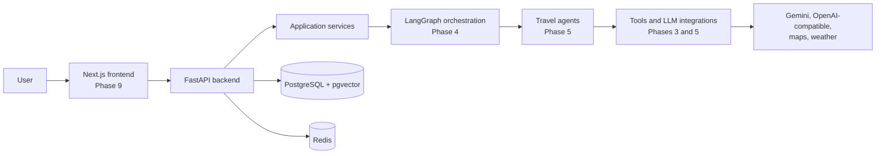

# TravelMind

TravelMind is an autonomous multi-agent AI travel-planning platform. This
repository is being built in ten phases; Phase 1 establishes the backend
foundation and local development infrastructure only.

## Architecture



## Requirements

- Docker Desktop with Docker Compose
- Python 3.11 or newer for local development outside Docker

## Local setup

1. Copy `.env.example` to `.env` and set credentials as needed. The supplied
   values are development-only.
2. Start the API and infrastructure:

   ```powershell
   docker compose up --build -d
   ```

3. Apply the database migration:

   ```powershell
   docker compose exec backend alembic upgrade head
   ```

4. Run the backend tests:

   ```powershell
   docker compose exec backend pytest
   ```

5. Check the API:

   ```powershell
   Invoke-RestMethod http://localhost:8000/health
   Invoke-RestMethod http://localhost:8000/version
   ```

Use `make up`, `make down`, `make logs`, `make migrate`, `make test`,
`make lint`, and `make format` where GNU Make is available.

## Phase checklist

- [ ] Phase 1 — Project Foundation (in progress)
- [ ] Phase 2 — Data models and schemas
- [ ] Phase 3 — Integrations and tools
- [ ] Phase 4 — Agent orchestration
- [ ] Phase 5 — Agents
- [ ] Phase 6 — Planning workflows
- [ ] Phase 7 — API capabilities
- [ ] Phase 8 — Reliability and observability
- [ ] Phase 9 — Frontend
- [ ] Phase 10 — Deployment and production readiness
